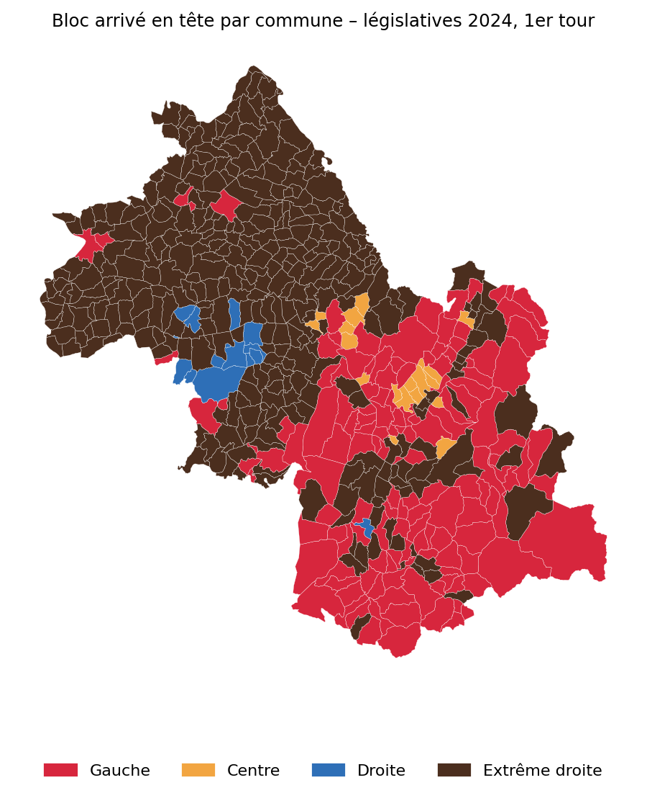
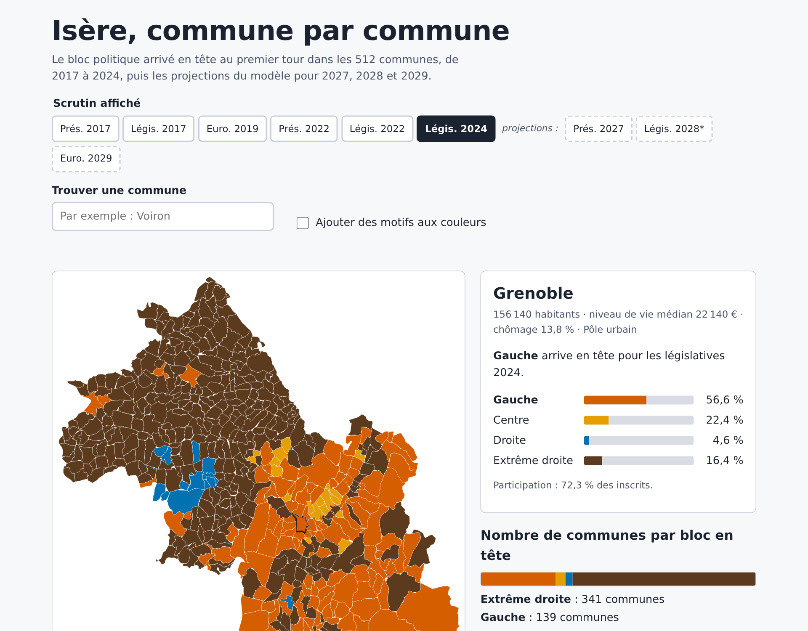
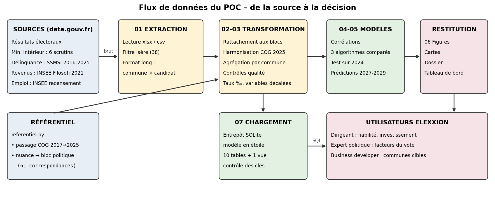

# Prédire les tendances électorales en Isère

**Preuve de concept pour la start-up Elexxion** · MSPR Bloc E7.3 « Big Data et analyse de données » · EPSI Grenoble, certification RNCP35584



## En bref

À partir de données publiques, nous prédisons le bloc politique arrivé en tête dans chacune des **512 communes de l'Isère**, puis projetons les tendances pour 2027, 2028 et 2029.

| Indicateur | Résultat |
|---|---|
| Données | 6 élections nationales (2017-2024), délinquance (SSMSI), revenus, chômage et population (INSEE) |
| Modèle retenu | Gradient Boosting pondéré |
| Fiabilité | **82,8 %** de bonnes prédictions sur une élection jamais vue (législatives 2024), contre 61 % pour une méthode naïve |
| Donnée la plus corrélée | Niveau de vie médian (ρ = +0,47 avec le vote centriste) |
| Projection présidentielle 2027 | Extrême droite en tête dans 342 communes, gauche dans 138 |

## Démonstration

**Tableau de bord interactif et accessible (RGAA / WCAG AA)** : ouvrir [`tableau_de_bord/tableau_de_bord_isere.html`](tableau_de_bord/tableau_de_bord_isere.html) dans un navigateur, ou consulter la version en ligne via GitHub Pages (lien dans la description du dépôt).



## Livrables

| Livrable | Emplacement |
|---|---|
| Rapport final (52 pages) | [`rapport/Rapport_final_MSPR_Bloc3_Elexxion.pdf`](rapport/Rapport_final_MSPR_Bloc3_Elexxion.pdf) |
| Support de soutenance | [`presentation/Soutenance_MSPR_Bloc3_Elexxion.pptx`](presentation/Soutenance_MSPR_Bloc3_Elexxion.pptx) |
| Tableau de bord | [`tableau_de_bord/`](tableau_de_bord/) et [`docs/`](docs/) (GitHub Pages) |
| Entrepôt SQL (modèle en étoile) | [`sql/elexxion_isere.db`](sql/), schéma [`sql/schema.sql`](sql/schema.sql) |
| Version NoSQL (un document par commune) | [`data_clean/nosql_communes.json`](data_clean/nosql_communes.json) |
| Requêtes d'analyse automatisées | [`sql/requetes_analyse.sql`](sql/requetes_analyse.sql), résultats dans [`resultats_requetes/`](resultats_requetes/) |
| Code commenté | [`scripts/`](scripts/) |
| Figures | [`figures/`](figures/) |

## Architecture



| Script | Rôle |
|---|---|
| `00_pipeline.py` | Orchestration de toute la chaîne, contrôle d'intégrité SHA-256 des sources |
| `referentiel.py` | Données de référence : communes fusionnées, nuances politiques → blocs |
| `01`, `01b`, `01c` | Extraction des élections, des revenus (Filosofi) et de l'emploi pour l'Isère |
| `02_transform.py` | Format unique, rattachement aux blocs, harmonisation, contrôles qualité |
| `03_features.py` | Variables du modèle (taux de délinquance, niveau de vie, chômage, élection précédente) |
| `04_modelisation.py` | Corrélations de Spearman et comparaison de 3 algorithmes |
| `05_modele_final.py` | Modèle retenu, évaluation sur 2024, projections 2027-2029 |
| `06_visualisations.py` | Cartes et graphiques |
| `07_base_sql.py` | Chargement de l'entrepôt SQLite |
| `08_schemas.py` | Schémas d'architecture |
| `09_backtest.py` | Validation sur deux élections |
| `10_typologie.py` | Typologie des communes (k-means, score de silhouette) |
| `11_requetes_nosql.py` | Requêtes SQL automatisées et export NoSQL |
| `12_tableau_de_bord.py` | Génération du tableau de bord accessible |


## Reproduire les résultats

```bash
pip install -r requirements.txt
# Télécharger les fichiers sources (voir ci-dessous) dans un dossier data_source/
python scripts/00_pipeline.py
```

Les extraits pour l'Isère sont déjà fournis dans `data_raw/` : les scripts 02 à 12 peuvent être relancés sans les fichiers nationaux, sauf pour les résultats 2017 et 2019.

## Sources (Licence Ouverte Etalab)

- [Données des élections – data.gouv.fr](https://www.data.gouv.fr/fr/pages/donnees-des-elections/) (ministère de l'Intérieur) : présidentielles 2017 et 2022, législatives 2017, 2022 et 2024, européennes 2019
- [Données sécurité – data.gouv.fr](https://www.data.gouv.fr/fr/pages/donnees-securite/) (SSMSI) : base communale de la délinquance enregistrée 2016-2025
- [Revenus et pauvreté des ménages en 2021 – INSEE](https://www.insee.fr/fr/statistiques/7756729) (Filosofi)
- [Emploi et population active en 2021 – INSEE](https://www.insee.fr/fr/statistiques/8202916) (recensement)

## Équipe

| Membre | Rôle |
|---|---|
| Samir FOUL | Expert en analyse politique |
| Charafeddine EZBIRI | Assistant |
| Akram KALAMI | Business developer, conception et développement de la solution |

## Avertissement

Les projections décrivent des tendances de territoires, avec une erreur moyenne de 5 à 13 points selon le bloc. Ce ne sont pas des sondages. Aucune donnée personnelle n'est utilisée.

## Licence

Code sous licence MIT. Données sous Licence Ouverte Etalab 2.0.
